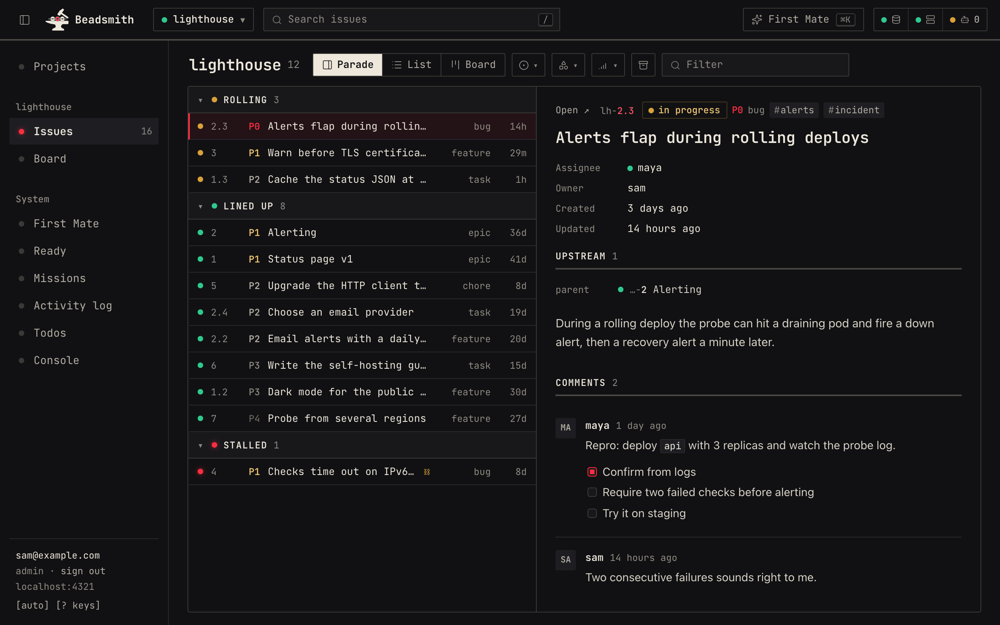

# Beadsmith

A web dashboard for [Beads](https://github.com/gastownhall/beads) projects.
Beadsmith reads your Beads issue databases from a Dolt SQL server and shows
every project, issue, dependency, and recent change in one place, for you and
the people you work with. Agents keep doing the work with `bd`; Beadsmith only
reads.



- **Every project at once.** Parade, list, and board views per project, a
  cross-project Ready deck of unblocked work, and an activity log.
- **Accounts.** Email and password sign-in with admin and member roles.
- **Backups.** Scheduled dumps of every project to any S3-compatible bucket,
  optionally encrypted with your passphrase.
- **Agents, optionally.** Send an issue to an agent to discuss, elaborate,
  close, or tackle it, through any runner that speaks a signed webhook.
- **Keyboard first** (`?` lists the keys) and usable at phone width.

> **Early and changing.** Beadsmith runs its author's own Beads server every
> day, but there are no versioned releases yet: `main` is what ships, and
> anything can change. Self-host it if that suits you.

## Quickstart

You need Docker with Compose v2. From a clone of this repository:

```sh
docker compose -f quickstart/compose.yaml up -d --build --wait
docker compose -f quickstart/compose.yaml exec beadsmith cat /state/setup-token
```

Open <http://localhost:4321>, paste the token, and create your admin account.
Three sample projects (`lighthouse`, `pantry`, `trailhead`) are waiting, with a
few weeks of made-up history and two agents mid-task.

The first start downloads two base images and builds Beadsmith, usually one
to three minutes; later starts take seconds. Everything stays on your machine: Beadsmith listens on `127.0.0.1` only, Dolt is not
published at all, and every secret is generated on first start. Stop with
`docker compose -f quickstart/compose.yaml down`; add `-v` to delete the sample
data and your account.

## Use your own Beads projects

Beadsmith connects to the Dolt sql-server your projects already use
(`bd init --server`) and shows every Beads database on it. It needs read
access only, so give it its own user:

```sql
CREATE USER 'beadsmith'@'%' IDENTIFIED BY 'a long random password';
GRANT SELECT ON *.* TO 'beadsmith'@'%';
```

On Dolt, `SELECT ON *.*` also covers `mysql.user`, so Beadsmith can read every
SQL account's password hash (unsalted `mysql_native_password`); Dolt 2.1 and
2.5 ignore `REVOKE SELECT ON mysql.*` after it. Give every account on that
server a long random password, which makes the hashes useless offline. To keep
Beadsmith away from them instead, grant per project
(``GRANT SELECT ON `my_project`.* TO 'beadsmith'@'%';``): Beadsmith then shows
only those projects, and each new one needs its own grant.

Then, from the repository root:

```sh
cp .env.example .env              # set BEADSMITH_UID/GID and the Dolt host
mkdir -p data secrets
(umask 077; cat > secrets/dolt-password)   # paste the password, then Ctrl-D
(umask 077; openssl rand -base64 32 > secrets/better-auth-secret)
docker compose up -d --build
cat data/setup-token              # one-time token for the first admin account
```

Open <http://localhost:4321> and create the admin account with the token. On a
server, put Beadsmith behind a reverse proxy or tunnel on the same machine; see
[docs/server-deployment.md](docs/server-deployment.md). Every variable is
listed in [docs/configuration.md](docs/configuration.md).

Upgrade by pinning a new `BEADSMITH_IMAGE` tag in `.env`, then
`docker compose pull && docker compose up -d`. CI publishes
`ghcr.io/<owner>/<repo>:<git-sha>` and `:latest` on each green push to `main`.

## Beads compatibility

Beadsmith reads the Beads schema directly, so it checks each project before
reading it. Every column it selects must exist; the bd version that last
wrote the database (`local_metadata.bd_version`) is shown in the console.
A project missing a column gets a clear "unsupported schema" error instead
of broken pages; other projects keep working.

| bd release | Schema migrations | Status                                         |
| ---------- | ----------------- | ---------------------------------------------- |
| 1.1.x      | 53                | Supported, tested in CI (1.1.2)                |
| 1.2.x      | 53                | Supported, tested in CI (1.2.2)                |
| 1.3.x      | 66                | Supported, tested in CI (1.3.1)                |
| newer      | —                 | Read if every column exists; shown as untested |

CI seeds a project with each release (`scripts/ci/seed-beads-db.sh`) and runs
`src/lib/server/dolt/compat.test.ts` against it. Add a release by extending
the `bd-compat` matrix in `.github/workflows/ci.yml` and `TESTED_BD_MINORS`
in `src/lib/server/dolt/schema.ts`.

## Accounts

Beadsmith has built-in accounts (Better Auth, email and password), turned on
by `BETTER_AUTH_SECRET_FILE`. Without them the service serves one implicit
operator and must stay on loopback (optionally behind Cloudflare Access).

- **First admin.** While no account exists, the server writes a one-time token
  to `setup-token` in the state directory (`data/` under Compose) and logs
  where it is. Open `/auth`, paste it, and the account you create is the admin.
  The file is deleted afterwards.
- **Roles.** `admin` uses the console (dispatch policy, checkout maps,
  accounts, backups) and launches agents. `member` reads every project and
  issue. Both can change their own password under Account.
- **More people.** In Console → Accounts an admin adds accounts with an initial
  password, changes roles, resets passwords, and removes accounts. Self sign-up
  is closed unless an admin opens it (new accounts are then members).
- **Cloudflare Access** stays optional. When configured it runs before
  sign-in, and an allowlisted service token keeps read-only `/api` access for
  machines ([docs/agent-access.md](docs/agent-access.md),
  [docs/public-access.md](docs/public-access.md)).

**Lost the last admin's password?** The console cannot reset it, so do it from
the machine that holds the state directory:

```sh
docker compose exec beadsmith node scripts/accounts.ts set-password you@example.com
```

It asks for the new password twice, shows nothing as you type, and signs that
account out everywhere. Beadsmith can keep running. Two more commands:
`promote you@example.com` makes an existing account an admin (also signing it
out), and `list` shows every account and its role. They run the same way.

- The password is never an argument, since arguments end up in shell history.
  To script it, pipe one line in:
  `docker compose exec -T beadsmith node scripts/accounts.ts set-password you@example.com < password-file`.
- If the container is stopped, use `docker compose run --rm beadsmith node scripts/accounts.ts ...`.
  For the quickstart, add `-f quickstart/compose.yaml`.
- Without Docker, run `pnpm run accounts ...` from a clone (after
  `pnpm install`) with `BDX_STATE_DIR` set to the state directory.

Design: [ADR-0011](specs/decisions/0011-accounts-and-roles.md).

## Backups

Console → Backups dumps every project database to any S3-compatible bucket
(Railway, S3, R2, B2, MinIO) on a schedule, optionally encrypted with your
passphrase; `pnpm run restore` loads a run back into Dolt. See
[docs/backups.md](docs/backups.md).

## Agents

Beadsmith never runs `bd` or writes issue rows. When an admin sends an issue
to an agent (the Agent action, `a`, or File/Tackle), Beadsmith records the
request and hands it to the configured provider, today your own runner over a
signed webhook (`BDX_DISPATCH_PROVIDER`). The agent then
changes Beads with `bd` like any other contributor. See
[docs/file-tackle-dispatch.md](docs/file-tackle-dispatch.md).

## Security model

The process has no local project filesystem, no Beads CLI, and no credential
helper or dotenv-loader dependency. It keeps the Dolt password out of state
databases, logs, URLs, browser storage, and API responses. SQL reads are
parameterized and single-statement; direct lifecycle writes are refused.
Host-header, same-origin, CSRF, session, CSP, rate-limit, and
response-secret-scrubbing controls are part of the service boundary.

## Development

With Node 24 and pnpm 12 (versions in `.node-version` and `package.json`):

```sh
pnpm install
pnpm run serve       # builds, then serves 127.0.0.1:4321
```

Or let Nix pin the toolchain ([devenv](https://devenv.sh); the same
[`nix/overlay.nix`](nix/overlay.nix) feeds CI, the image and the VM test):

```sh
devenv shell         # Node, pnpm, bd and Dolt at the pinned versions
devenv test          # pnpm install, check, test
nix flake check      # the same gates in the Nix sandbox (+ the NixOS VM test on Linux)
```

Point it at a Dolt server with `BEADS_DOLT_SERVER_HOST` and friends; see
[Running from source](docs/configuration.md#running-from-source). Before a
pull request:

```sh
pnpm run check
pnpm run test
pnpm run build
pnpm run format:check
pnpm run audit
```

`pnpm run audit` fails on high/critical advisories; pins are in
[docs/dependency-audit.md](docs/dependency-audit.md). The quickstart sample
projects live in [`quickstart/sample/projects.ts`](quickstart/sample/projects.ts);
`pnpm run quickstart:sample /path/to/bd` regenerates the SQL from them.

The maintainer's own deployment is declared here too, in the
[ghuntley/overalls](https://github.com/ghuntley/overalls) layout:
[`fleet/hosts/beads`](fleet/hosts/beads) with sops-encrypted secrets in
[`fleet/secrets`](fleet/secrets). A green push to `main` moves the `deploy`
branch, and the host updates itself from it
([ADR-0014](specs/decisions/0014-public-repo-nix-and-fleet.md),
[operations guides](docs/operations/README.md)).

Architecture: [`specs/README.md`](specs/README.md), with numbered decisions in
[`specs/decisions/`](specs/decisions/) and the product and security contract
in [`docs/contract.md`](docs/contract.md).

The project website, [beadsmith.ericevans.dev](https://beadsmith.ericevans.dev)
(a landing page plus this README and `docs/` as pages), is a static site in
[`site/`](site/README.md).

## Security

Please report vulnerabilities through a
[private security advisory](https://github.com/Vonshlovens/beadsmith/security/advisories/new),
not a public issue. See [SECURITY.md](SECURITY.md).

## Contributing

Issues and outside pull requests are closed for now; questions and ideas are
welcome in [Discussions](https://github.com/Vonshlovens/beadsmith/discussions).
The reasoning behind the code lives in this repository: start with
[`specs/README.md`](specs/README.md) and the decisions it links.

## License

MIT, see [LICENSE](LICENSE). Bundled dependencies are listed in
[THIRD_PARTY_NOTICES.md](THIRD_PARTY_NOTICES.md).
