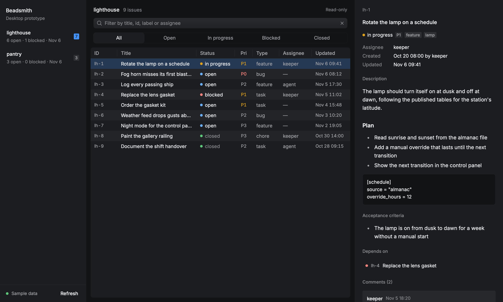
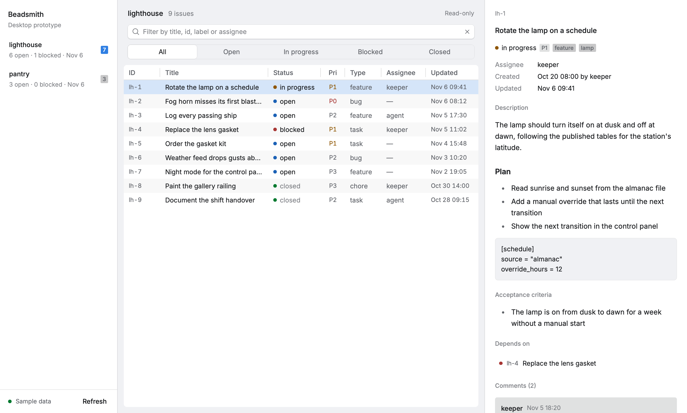
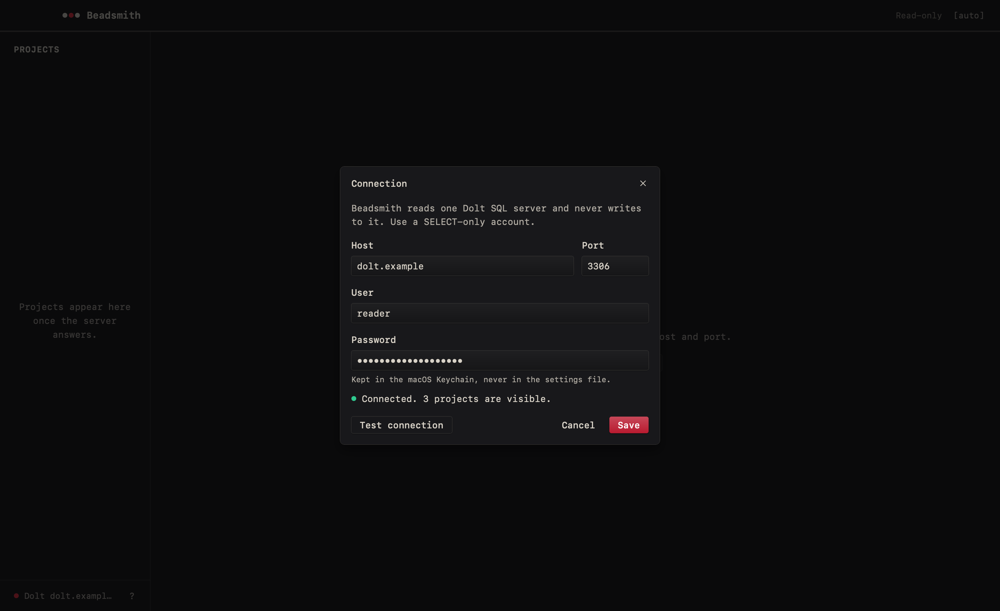

# Beadsmith desktop (prototype)

A native desktop client for Beadsmith, built on
[Rune](https://github.com/anomalyco/rune), a GPU-rendered Rust UI framework.
It is a prototype for deciding whether a native port is worth carrying: it
covers the web app's read path for one project at a time, and nothing else.
The decision record is
[ADR-0017](../specs/decisions/0017-native-desktop-prototype.md).





## What it does

- Lists the projects (user databases) on one Dolt server, with open, blocked
  and last-activity summaries.
- Shows a project's issues in a sortable, virtualised table, filtered by
  status and by text (title, id, label or assignee).
- Answers "what can be picked up now?": the Ready filter keeps the open
  issues nothing blocks, by the rule of the web app's Ready deck, and the
  Blockers column says how many unfinished issues each of the others waits
  on. See [Ready and blockers](#ready-and-blockers).
- Shows the selected issue: Markdown description, design, acceptance
  criteria and notes, labels, dependencies both ways and comments. A
  dependency is a link: follow it, and the ones after it, then come back the
  way you came with the arrows above the issue or `⌘[` and `⌘]`.
- Jumps anywhere with quick open (`⌘K`): type a project's name, or an issue's
  id or part of its title, and go to it in whichever project holds it. See
  [Quick open](#quick-open).
- Works from the keyboard: every action has a key, listed under
  [Keyboard](#keyboard) and in the app on `?`.
- Refreshes on the Refresh button above the table, `r` or `⌘R`. A refresh
  that fails keeps what was on screen under a banner that says it may be out
  of date; a failed read never shows as an empty list.
- Keeps itself current: it re-reads every minute and when its window comes
  back to the front, without moving the selection, the scroll position, the
  sort or the filters. The toolbar says how old the list is ("Updated 3 min
  ago") and holds the interval (off, 30 s, 1, 5 or 15 min). See
  [Automatic refresh](#automatic-refresh).
- Says what is happening in every pane: outlines of the rows while they
  load, an empty project, filters that match nothing (with Clear filters),
  and each connection failure with Retry and Connection settings.
- Follows the system's light or dark theme, or the one chosen in the title
  bar (`[auto]`, `[light]`, `[dark]`, as in the web app).
- Opens where it was left: the same project, status tab, sort, theme choice
  and window size. See [What a relaunch remembers](#what-a-relaunch-remembers).
- Keeps its connection: host, port and user in a settings file, the password
  in the macOS Keychain, set from a connection screen that can test them
  first.

It reads only. Dispatch, accounts, the console, backups, the board, the
Ready deck across projects, todos and the command palette's actions are
web-only.

## Ready and blockers

An issue is ready when its status is `open` and none of its `blocks`
dependencies points at an issue that is not closed. A blocker that is not in
the project counts as unfinished, because nothing says it is done. Work in
progress and issues marked `blocked` by hand are never ready. This is the
web app's rule, `listReadyIssues` in
[`src/lib/server/dolt/client.ts`](../src/lib/server/dolt/client.ts); the
desktop app selects the same predicate as a count per issue
(`count_columns` in [`src/dolt.rs`](src/dolt.rs)), inside the one statement
that lists a project, so Ready costs no query of its own and none per row.
A test that needs a server (`ready_matches_the_web_apps_query`) runs the web
app's statement beside it and compares the answers.

The Blocked filter is still the stored status. The Blockers column is the
computed side: an open issue with a number there is open but not ready.
Dependencies of other types (`related`, `parent-child`, `discovered-from`)
link issues without blocking; the issue pane names the type beside them.

Following a dependency link leaves a trail, shown as back and forward
arrows above the issue. Choosing an issue in the list starts a new one: the
trail is for a chain of blockers, not for every row passed on the way.

## Automatic refresh

The window re-reads the project list, the open project's issues and the
issue being read on the interval chosen beside the Refresh button, and once
more when it regains focus if its data is more than five seconds old. That
second rule is there because the moment you come back to the window is when
you read it, and macOS may hold a hidden app's timers back.

- Nothing blanks or jumps. New rows arrive under the same selection, sort
  and filters, which are kept by issue id and column rather than by row. A
  bead pulses beside the list's age while a read is in flight; the Refresh
  button only turns busy for a refresh you asked for.
- A read is never started while another is in flight, so a server slower
  than the interval is not asked faster than it answers.
- A read that fails over loaded data shows the same banner as a failed
  manual refresh, and the age keeps counting from the last good list. An
  unreachable server is asked again on the interval. A rejected or missing
  password is not: retrying it every minute could lock the account or make
  the Keychain prompt repeatedly, so the window waits for Retry.
- Nothing is read behind an open dialog.
- "Auto off" turns off both the interval and the read on focus.

The interval is saved as `refresh.seconds` in the settings file described
under [Where the connection is kept](#where-the-connection-is-kept). A
missing or unrecognised value is one minute.

## How it looks

The desktop app is meant to read as the same product as the web app, so it
takes its palette, type scale, radii and status and priority colours from the
web app's tokens in [`src/app.css`](../src/app.css). Rune has no CSS, so
[`src/theme.rs`](src/theme.rs) restates them once, each field named after the
custom property it copies; change a token in `app.css` first and mirror it
there. A unit test holds every text role to 4.5:1 on the surfaces it sits on,
in both themes.

- The interface is set in the platform's monospaced UI font (SF Mono on
  macOS), standing in for the web app's JetBrains Mono without bundling a
  font file. Issue bodies and comments read in a sans, as on the web. A
  machine with no system monospace font falls back to Rune's built-in Inter,
  so a snapshot rendered elsewhere can differ in typeface.
- On macOS the window has no separate title bar: the app's own bar holds the
  window buttons and drags the window.
- Below 1280 points wide the table drops its Type and Assignee columns (the
  detail pane shows both) so titles keep their room.

## Keyboard

Every action is reachable without a pointer. Keys follow the web app's
([`docs/keyboard.md`](../docs/keyboard.md)) wherever both define the action;
`?` (or the `?` button under the project list) shows this list in the app. `⌘`
is Ctrl off macOS. Plain keys never fire while you type in a field.

| Keys                 | Does                                                                           |
| -------------------- | ------------------------------------------------------------------------------ |
| `j` / `↓`            | Next issue                                                                     |
| `k` / `↑`            | Previous issue                                                                 |
| `Home` / `End`       | First or last issue                                                            |
| `o` / `Enter`        | Read the selected issue                                                        |
| `s`                  | Sort by the next column                                                        |
| `⇧S`                 | Reverse the sort                                                               |
| `/` / `⌘F`           | Filter issues                                                                  |
| `j` / `↓` / `Space`  | Page down                                                                      |
| `k` / `↑` / `⇧Space` | Page up                                                                        |
| `Home` / `End`       | Top or bottom                                                                  |
| `Tab`                | Step through its links                                                         |
| `⌘[`                 | Back to the issue a link was followed from                                     |
| `⌘]`                 | Forward again                                                                  |
| `Esc`                | Back: leave the field or the issue, then clear the filters, then the selection |
| `⌘K`                 | Quick open: jump to a project, or to an issue in any project                   |
| `⌘1–9`               | Switch to that project in the sidebar                                          |
| `r` / `⌘R`           | Refresh                                                                        |
| `⌘,`                 | Connection settings                                                            |
| `t`                  | Switch theme: auto, light, dark                                                |
| `?`                  | Keyboard shortcuts                                                             |
| `⌘W`                 | Close the window                                                               |
| `⌘Q`                 | Quit                                                                           |

The list has two modes, as a mail client does. In the list, `j` and `k` move
the selection and keep its row in view. `Enter` hands the keyboard to the
issue on the right (a ring marks the pane): the same keys then page through
it, `Tab` walks its dependency links, and `Esc` returns to the list. In the
filter field, `Enter` or `↓` moves to the matches.

The list is `SHORTCUTS` in [`src/keys.rs`](src/keys.rs), where one function
maps keys to commands and another runs them; a unit test fails if this table
and that list disagree.

On macOS the same commands are in the menu bar (the application menu, View,
Go and Help), and Edit and Window are the system's standard ones, so `⌘W`,
`⌘M` and `⌘Q` behave as in any Mac app. Rune has no native menus on Linux or
Windows; there `Ctrl+W` and `Ctrl+Q` are bound by the app itself.

## The read contract

The client keeps the web app's Dolt contract
([ADR-0003](../specs/decisions/0003-dolt-read-plane.md)), ported from
[`src/lib/server/dolt/client.ts`](../src/lib/server/dolt/client.ts) into
[`src/dolt.rs`](src/dolt.rs):

- one configured server; single `SELECT`/`SHOW` statements with bound
  parameters; database names validated against `^[a-z0-9_]{1,64}$`, never
  escaped;
- each session asks for `SET SESSION TRANSACTION READ ONLY`;
- failures reduce to the same fixed classes (credential unavailable,
  authentication rejected, unreachable, unknown), read from driver codes and
  never from driver messages, which can contain hosts or user names.

Use a SELECT-only Dolt account, as the web service does
([ADR-0013](../specs/decisions/0013-owner-account-and-global-readers.md)).

Every read runs on a Rune worker (`rune::Latest`), so the window never waits
on the network, and a newer request supersedes an older one.

## Run it

You need the Rust toolchain in [`rust-toolchain.toml`](rust-toolchain.toml)
(rustup installs it on first use). On Linux, building also needs the
`libxkbcommon` and `libwayland` development packages (Rune's
[Linux notes](https://github.com/anomalyco/rune/blob/dev/crates/rune/README.md#linux)):

```sh
sudo apt-get install libxkbcommon-dev libwayland-dev   # Debian/Ubuntu
```

Then, from this directory:

```sh
cargo run --release -- --sample      # built-in sample data, no server
```

Against a Dolt server, start it with no arguments:

```sh
cargo run --release
```

The first launch opens the connection screen. Enter the host, port, user and
password, press **Test connection** to see whether the server answers and how
many projects the account can see, then **Save**. Later launches reconnect
without asking. The screen reopens from the server name at the bottom of the
sidebar.



## Install it on macOS

`cargo run` gives a bare binary: no Dock icon, no place in `/Applications`.
[`scripts/bundle-macos.sh`](scripts/bundle-macos.sh) wraps the release binary
in `Beadsmith.app`, using only tools macOS ships:

```sh
scripts/bundle-macos.sh              # target/bundle/Beadsmith.app
scripts/bundle-macos.sh install      # build, then copy to /Applications
scripts/bundle-macos.sh uninstall    # remove /Applications/Beadsmith.app
```

`BEADSMITH_INSTALL_DIR` installs somewhere else, such as `~/Applications`.
Try a build without installing it, on the sample data:

```sh
open target/bundle/Beadsmith.app --args --sample
```

The bundle's version is the crate's, read from [`Cargo.toml`](Cargo.toml).
Its icon is rendered from [`assets/icon.svg`](assets/icon.svg), the Beadsmith
mark redrawn as vectors because the web app's copies are too small for a
1024 px icon; the rendered sizes are left in `target/bundle/Beadsmith.iconset`.

The app is signed ad hoc, which has two consequences:

- It runs on the Mac that built it. Another Mac's Gatekeeper refuses a
  downloaded copy until its quarantine attribute is cleared
  ([Install a downloaded build](#install-a-downloaded-build)): opening it
  without that step needs a Developer ID signature and notarization, which
  need Apple credentials this repository does not have.
  `BEADSMITH_SIGN_IDENTITY` signs with an identity from your keychain
  instead.
- An ad-hoc signature identifies one exact build, so after installing a new
  build macOS asks once more whether Beadsmith may read its `Beadsmith Dolt`
  Keychain item. Choose **Always Allow**.

Uninstalling removes the app only. The settings file and the Keychain item
stay; [Where the connection is kept](#where-the-connection-is-kept) says how
to remove them.

## Install a downloaded build

Tagged versions are built by GitHub Actions and attached to the
repository's [releases](https://github.com/Vonshlovens/beadsmith/releases)
as `Beadsmith-<version>-macos-universal.zip`, one app for Apple silicon and
Intel Macs on macOS 13 or later, with a `.sha256` file beside it.

The build is not notarized. Developer ID signing and notarization need a
paid Apple Developer account and its credentials, which this repository does
not have, so the release is signed ad hoc like a local build. macOS marks
anything a browser downloads as quarantined and refuses to open a quarantined
app that is not notarized ("Beadsmith is damaged and can't be opened", or
"Apple could not verify…"). Clearing the mark is the step that says you trust
this download, so check it first:

```sh
cd ~/Downloads
shasum -a 256 -c Beadsmith-<version>-macos-universal.zip.sha256
ditto -x -k Beadsmith-<version>-macos-universal.zip .
xattr -dr com.apple.quarantine Beadsmith.app
mv Beadsmith.app /Applications/
```

The checksum shows the zip arrived as GitHub has it; it does not show who
built it. If that matters, build it yourself with the script above: the
release is that script's output.

Unpacking with `ditto` (or by double-clicking the zip) keeps the signature
intact. `xattr -dr` removes the quarantine mark from the app and everything
in it; without it, **System Settings › Privacy & Security › Open Anyway**
after a refused launch does the same for most macOS versions.

## Cut a release

[`.github/workflows/desktop-release.yml`](../.github/workflows/desktop-release.yml)
runs on tags named `desktop-v<version>`:

1. Bump `version` in [`Cargo.toml`](Cargo.toml) (and `Cargo.lock`, which
   `cargo build` updates) and merge that.
2. Tag the merged commit `desktop-v<version>` and push the tag.

The workflow fails before building if the tag and `Cargo.toml` disagree,
runs the tests, builds both architectures, and runs
`scripts/bundle-macos.sh package`, which joins them into one universal app,
signs it, zips it and writes the checksum. A second job, the only one with
write access, attaches the two files to a GitHub Release for the tag.
Running the workflow by hand from a branch does everything but release: the
zip and checksum are kept as a workflow artifact for 14 days.

The same packaging runs locally, for the host architecture unless
`BEADSMITH_TARGETS` names more (each needs `rustup target add`):

```sh
scripts/bundle-macos.sh package      # target/bundle/Beadsmith-<version>-macos-<arch>.zip and .sha256
```

## Where the connection is kept

| What                | Where                                                                                                                                                             |
| ------------------- | ----------------------------------------------------------------------------------------------------------------------------------------------------------------- |
| Host, port and user | `prefs.json` in the OS config folder: `~/Library/Application Support/Beadsmith` on macOS, `$XDG_CONFIG_HOME/Beadsmith` on Linux, `%APPDATA%\Beadsmith` on Windows |
| Refresh interval    | `refresh.seconds` in the same `prefs.json` (see [Automatic refresh](#automatic-refresh))                                                                          |
| The view            | `view.*`, `ui.theme` and `window.size` in the same `prefs.json` (see [What a relaunch remembers](#what-a-relaunch-remembers))                                     |
| Password, on macOS  | The login Keychain, as a generic password named `Beadsmith Dolt` with the account `user@host:port`                                                                |
| Password, elsewhere | Not stored: this build has no keychain binding off macOS, so set `BEADS_DOLT_PASSWORD_FILE`                                                                       |

The password is never written to the settings file, a log or a command line.
It is saved for one `user@host:port`, so changing the host and leaving the
password blank fails with "no password is available" instead of sending the
saved password to a different server. A blank password on Save keeps the one
already saved. The app reads the Keychain only when it connects, on a worker
thread, never to fill in the form.

To forget a connection, delete `prefs.json` and remove the `Beadsmith Dolt`
item in Keychain Access.

## What a relaunch remembers

The window opens on the view it was closed on. Each choice is written to
`prefs.json` when it is made, not at quit, so a crash loses nothing; the
window's size is written when the window closes.

| Key                                 | Holds                                                     |
| ----------------------------------- | --------------------------------------------------------- |
| `view.project`                      | The project last open                                     |
| `view.status`                       | The status tab, by its label; absent for All              |
| `view.sort`, `view.sort_descending` | The sorted column and its direction; absent when unsorted |
| `ui.theme`                          | `light` or `dark`; absent to follow the system            |
| `window.size`                       | The window's content size in points, `[width, height]`    |

The filter text is not kept: a list that opens already narrowed by words
typed last week reads as missing issues. The selected issue is not kept
either, since the list it was chosen from may have changed.

Nothing here can stop a launch. A file that does not parse is set aside as
`prefs.json.bad` and the app starts from its defaults. A value it cannot
use (a project no longer on the server, a tab or column this version does
not have, a size that is not two positive numbers) is dropped by itself:
that choice starts from its default and the rest are kept. A full-screen
window does not overwrite the saved size.

The window's position is not remembered yet: Rune can place a window but
has no call that says where one is.

The web service's variables still work and win over the settings file, one
field at a time, so a shell can point a single run somewhere else:

| Variable                   | Default |                                                |
| -------------------------- | ------- | ---------------------------------------------- |
| `BEADS_DOLT_SERVER_HOST`   | saved   | With neither, the connection screen opens      |
| `BEADS_DOLT_SERVER_PORT`   | `3306`  |                                                |
| `BEADS_DOLT_SERVER_USER`   | `root`  | Use a SELECT-only account                      |
| `BEADS_DOLT_PASSWORD_FILE` | —       | Preferred; one trailing line ending is dropped |
| `BEADS_DOLT_PASSWORD`      | —       | Used only when no password file is set         |

The password is looked for in that order, then in the Keychain. The
connection screen shows a field the environment sets as read-only and names
the variable.

```sh
BEADS_DOLT_SERVER_HOST=127.0.0.1 BEADS_DOLT_SERVER_USER=beadsmith \
BEADS_DOLT_PASSWORD_FILE=/path/to/password cargo run --release
```

The repository's [quickstart](../quickstart/compose.yaml) serves three sample
projects; publish its Dolt port to point the client at it.

There is no TLS yet: connect over loopback, an SSH tunnel or a private
network, not across the internet.

## Check it headlessly

Rune renders any app without a window, on the same renderer:

```sh
cargo run -- --list-scenes
cargo run -- --snap sample.png --scene sample [--theme light]
cargo run -- --tree tree.json --scene filtered     # the element tree as JSON
```

Scenes fill state directly, so they need no server. `--list-scenes` names
them all: the data (`sample`, `filtered`, `ready`), every pane while it loads
(`loading`, `loading-issues`, `loading-issue`), the empty and failed states
(`no-projects`, `empty-project`, `no-matches`, `issue-gone`, `unconfigured`,
`unreachable`, `auth-rejected`, `credential-unavailable`, `issues-failed`,
`issue-failed`), a failed refresh over loaded data (`stale`), the window
re-reading by itself (`refreshing`) and its interval being chosen
(`auto-refresh`), the
connection screen (`connection` for a first launch, then `connection-*`),
an issue being read from the keyboard (`reading`), one reached by
following dependency links (`trail`, and `trail-gone` for a link to an issue
that is not there), a theme chosen against the system's (`theme-light`,
`theme-dark`) and the shortcuts list (`shortcuts`).
A headless run reads no environment, settings file
or keychain, so an image depends on its scene alone. The screenshots above
are `--snap docs/sample-dark.png --scene sample`, the same with
`--theme light`, and `--scene connection-ok`.

To render every scene in both themes at once, as CI does:

```sh
scripts/snap-scenes.sh            # target/scenes/<scene>-<theme>.png
```

Keys can be exercised the same way: a script of timed key presses runs
against a scene through the real key routing. The clock is virtual, so a
script can also sit through refresh intervals, and `{"t":30,"focus":true}`
brings the window to the front.

```sh
echo '[{"t":0.1,"type":"key","name":"j"},{"t":0.3,"type":"key","name":"Enter"}]' > keys.json
cargo run -- --script keys.json --snap after.png --at 0.8 --scene sample
```

Snapshots render on the GPU path. A Linux machine without a GPU needs a
software Vulkan driver (`mesa-vulkan-drivers` on Debian/Ubuntu, with
`VK_ICD_FILENAMES` pointing at its `lvp_icd*.json`).

## Tests

```sh
cargo fmt --check
cargo clippy --all-targets -- -D warnings
cargo test                       # unit tests: no server, no keychain
BEADS_DOLT_SERVER_HOST=127.0.0.1 BEADS_DOLT_SERVER_USER=beadsmith \
BEADS_DOLT_PASSWORD=… cargo test -- --ignored --skip keychain   # a live server
cargo test -- --ignored keychain # macOS: the real Keychain
```

The live-server tests read, and save a connection to a scratch settings file
and relaunch from it. The Keychain test writes one item under a test-only
service name and deletes it.

CI runs the first three and `scripts/snap-scenes.sh` on macOS and Linux for
every pull request and push to `main` that touches `desktop/`
([`.github/workflows/desktop.yml`](../.github/workflows/desktop.yml)), and
uploads the scene images as an artifact. It is a separate workflow from the
web app's, so neither waits on the other.

## Quick open

`⌘K` (or Go > Quick Open…) opens a field over the window. With nothing typed
it lists the projects, so it is also a project switcher. Typing matches
project names and, in every project on the server, issue ids and titles:
the characters typed have to appear in that order, not side by side, so
`fghrn` finds "Fog horn …". The closest match is first: the whole text, then
a leading match, then a word start, then the inside of a word, then scattered
characters; an id outranks a project name, which outranks a title, and a
shorter text wins a tie. `↑`/`↓` (or `Ctrl-N`/`Ctrl-P`) move, `Enter` opens,
`Esc` closes.

Choosing an issue in another project switches to that project with the issue
selected and open; its row is scrolled to when the list arrives.

Projects are matched in the app. Issues are one bounded read per project
(`Source::search` in [`src/dolt.rs`](src/dolt.rs)): a parameterized `SELECT`
with `LIKE` on the id and title, the typed text bound as a value with its
wildcards escaped, at most 50 rows, the closest first. It runs on a worker
after typing pauses, and a newer query replaces an older one. The ranking is
[`src/quick.rs`](src/quick.rs). If the read fails, the projects still match
and the palette says the issues are missing.

## Layout

| File                                 | Role                                              |
| ------------------------------------ | ------------------------------------------------- |
| [`src/main.rs`](src/main.rs)         | Entry point: picks the data source, scenes, keys  |
| [`src/app.rs`](src/app.rs)           | State, requests on workers, filtering and sorting |
| [`src/view.rs`](src/view.rs)         | The window: projects, issue table, issue detail   |
| [`src/keys.rs`](src/keys.rs)         | Keys to commands, the menu bar, the shortcut list |
| [`src/quick.rs`](src/quick.rs)       | Quick open's matching and ranking                 |
| [`src/dolt.rs`](src/dolt.rs)         | The Dolt read plane                               |
| [`src/settings.rs`](src/settings.rs) | Environment, settings file and keychain           |
| [`src/model.rs`](src/model.rs)       | Read-model types and the failure classes          |
| [`src/sample.rs`](src/sample.rs)     | Built-in sample data                              |

Rune is pre-release and asks apps to pin a revision of its `dev` branch; the
pin is in [`Cargo.toml`](Cargo.toml).

## Not done yet

- TLS to the Dolt server.
- Storing the password off macOS (Secret Service, Windows Credential
  Manager).
- Talking to a Beadsmith server's API instead of Dolt, which would bring
  accounts and the project gate (see the ADR's alternatives).
- Developer ID signing and notarization of the macOS download. Bundles for
  Linux and Windows.
- The board, the Ready deck across projects, the activity feed, full-text
  search of issue bodies and comments, and any writes.
