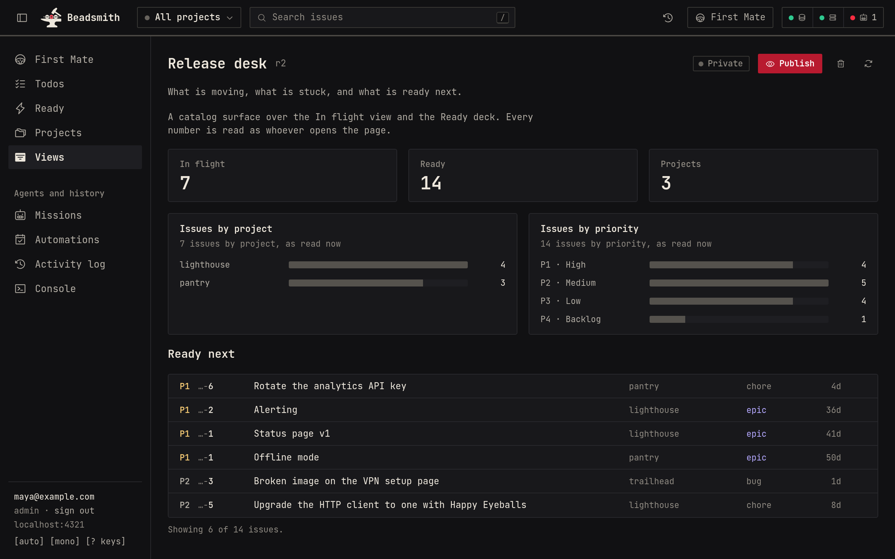

# Views, surfaces and apps

Beadsmith can grow new screens without a release. Admins and First Mate add
them as data, kept with a full history in Beadsmith's own state database,
and everyone who opens one sees it through their own account. The decision
and its rules are in
[ADR-0025](../specs/decisions/0025-grown-capabilities.md).

There are three kinds, from most to least constrained. A request goes to the
simplest kind that can express it:

| Kind                | What it is                                                                                         | Who makes it                                                |
| ------------------- | -------------------------------------------------------------------------------------------------- | ----------------------------------------------------------- |
| **Saved view**      | A scope (one project or all), filters, a sort and a list or board. No SQL, ever.                   | An admin from a project page (**Save view**), or First Mate |
| **Catalog surface** | A dashboard built from Beadsmith's own components: stat tiles, issue lists and boards, bar charts. | First Mate, or an admin through `/api/surfaces`             |
| **Sandboxed app**   | HTML and JavaScript First Mate writes, for what the catalog cannot show.                           | First Mate on a Sand chat, or an admin through `/api/apps`  |

All three live at `/views/<slug>`, and **Views** in the rail lists them:
name, project, who wrote it (a person or First Mate), last change, and who
can see it.

## Who sees what

- **New things are private.** A view, surface or app is visible to its owner
  alone until an admin publishes it. Publishing shares one revision: members
  see that revision, the owner keeps editing the latest. A change First Mate
  makes later stays private until an admin publishes again, so an agent never
  changes what members see on its own.
- **Everything runs as the viewer.** A grown thing has no authority of its
  own. Its data is read, and its buttons act, as the signed-in person
  looking at it. An admin's dashboard opened by a member reads what that
  member can read and cannot launch anything.
- **Every change is a revision.** Each create, edit and revert adds one, with
  its author. The owner sees the history on the thing's page and can revert,
  publish, unpublish or delete it. First Mate's changes also show in its chat
  as activity lines with a link.

## Saved views

On a project page, set the filters you want (status, type, priority, label,
assignee, text) and choose **Save view**. The view keeps the filters and the
presentation (parade, list or board) and runs through the same read path as
the project page. An all-projects view reads every project you can see, and
says so when it skips one it cannot read. Table sorting is not part of the
URL, so it is not saved.

First Mate saves views with its crew tools too (`define_view`, `run_view`,
and history and revert), and reuses them instead of rebuilding a query.

## Catalog surfaces

A surface is a JSON tree over a fixed catalog of components: layout (stack,
row), headings, text, Markdown, stat tiles, issue lists, issue boards, bar
charts and buttons. Each piece of data is bound to a saved view or to an
allowlisted read (projects, ready work, issues, one issue, missions). The
tree is checked when it is saved, so an unknown component or prop is
refused rather than skipped. Text is text; Markdown goes through the app's
sanitizing renderer.

Buttons run allowlisted actions only: todo changes and mission launches,
under dispatch's usual arm switch, project allow-list and repository map.
Beadsmith shows its own confirmation, naming the operation, project and
issue, before anything is written or launched; the surface cannot draw or
skip it.

## Sandboxed apps

An app is a document First Mate writes when the catalog is not enough.
Nothing it contains runs on the server. It runs only in the viewer's
browser, in a sandboxed frame with an opaque origin and no network at all:
no `fetch`, no external scripts, styles, fonts or images. It cannot read
Beadsmith's cookies or page. Libraries come from a vendored allowlist pinned
by version and hash in the repository; today that is Chart.js and
Beadsmith's design tokens. The app reads and acts through the same bridge
and allowlist as a surface, with the same host confirmation for actions.

## Change this

When none of the three can do what you want, ask for code. Admins press
`\` (or the crosshair in the top bar) while dispatch is armed, point at
any part of a page, describe the change, and send it. Beadsmith files it as
a File mission against the project you chose, with the page and the element
as context; First Mate's `request_code_change` tool does the same from a
chat. The keys are in [keyboard.md](keyboard.md#change-this-admins).

First Mate can also propose an automation (a scheduled launch). It is
created paused and marked as First Mate's on `/automations`, and only a
person can resume it.

## What needs what

- **Saved views** need nothing beyond a running Beadsmith.
- **Surfaces and apps** render anywhere; First Mate writes them only on a
  chat with crew tools, which today means a Sand chat
  ([sand-e2b.md](sand-e2b.md)).
- **Buttons, app actions and Change this** need a dispatch provider
  ([file-tackle-dispatch.md](file-tackle-dispatch.md#providers)).

Not built yet: exporting apps to other MCP clients as `ui://` resources.
